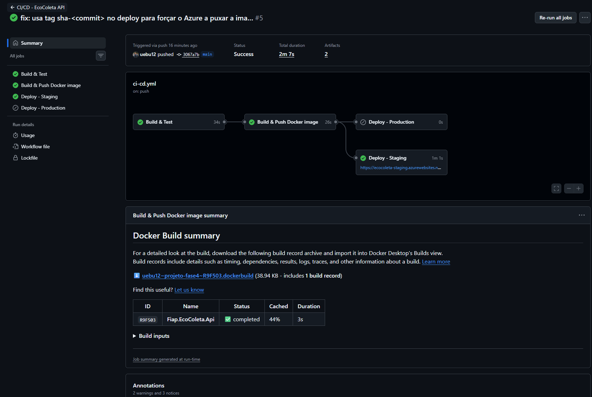
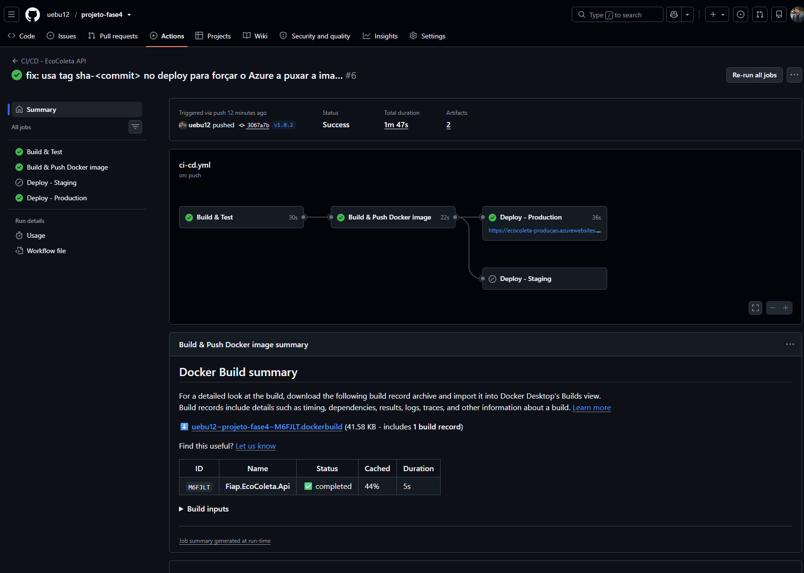
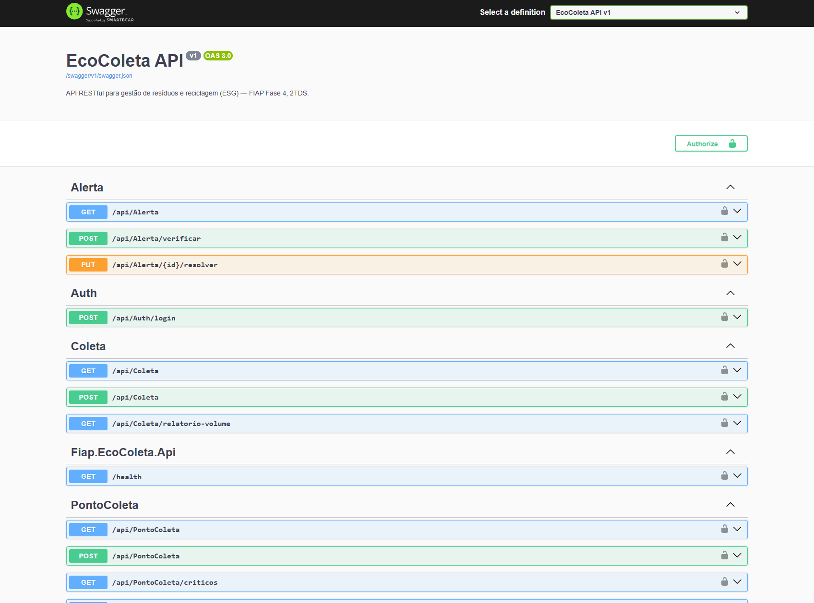
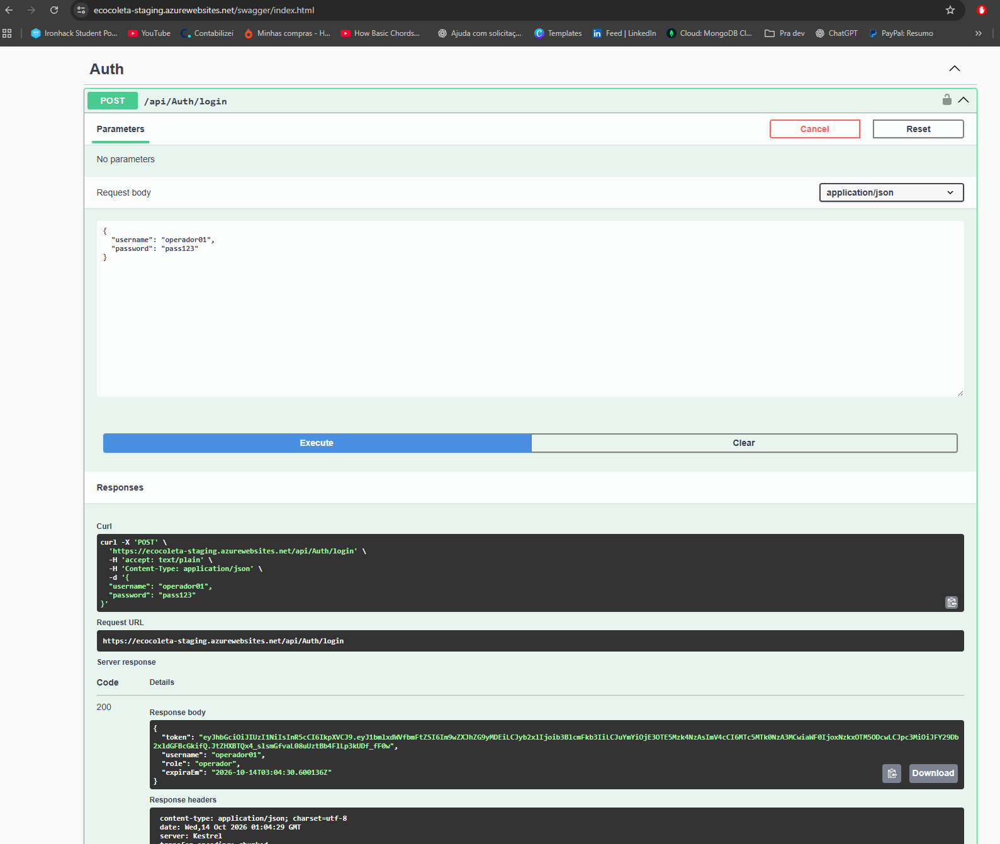
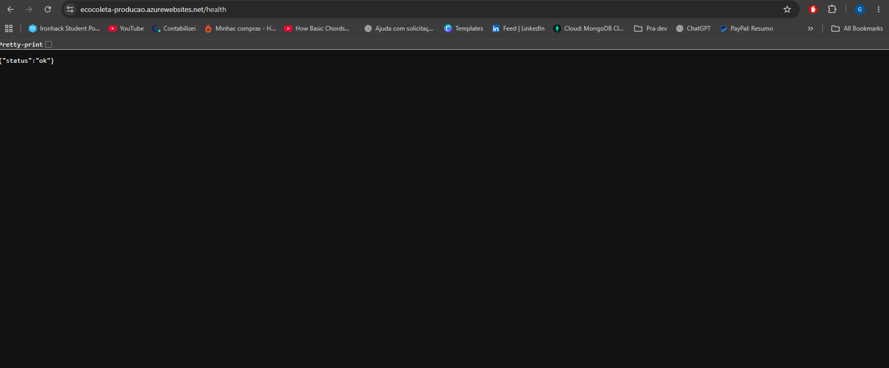
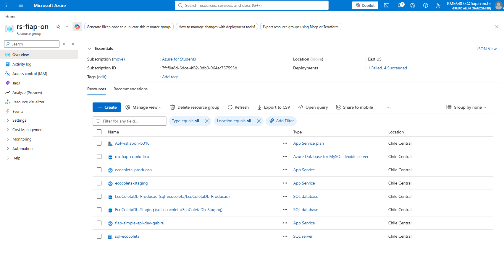

# Projeto - Cidades ESG Inteligentes — EcoColeta API

API RESTful em **ASP.NET Core 8** para gestão de resíduos e reciclagem — tema ESG
**"Gestão de Resíduos e Reciclagem"** (FIAP, Fase 4, 2TDS), agora com pipeline
completo de **CI/CD, containerização e deploy em dois ambientes** (desafio da
fase "Navegando pelo mundo DevOps").

Permite cadastrar pontos de coleta seletiva, registrar coletas de diferentes
tipos de resíduo, gerar **alertas automáticos** quando a capacidade de um ponto
se aproxima do limite, e produzir **relatórios ESG** com estimativa de impacto
ambiental (CO2 evitado / equivalente em árvores preservadas).

**Integrantes:**
- Gabriel Rodrigues de Lima Furquim de Moraes
- Raphael Henrique Soares Semede ([raphasemede@gmail.com](mailto:raphasemede@gmail.com))
- Crystian Lopes do Carmo ([crystianlopes8@outlook.com](mailto:crystianlopes8@outlook.com))
- Jefferson Nery Martins ([jefferson.nery.me@gmail.com](mailto:jefferson.nery.me@gmail.com))

## ✅ Status do projeto

|Verificação|Resultado|
|-|-|
|Build|✅ Succeeded|
|Testes automatizados|✅ `10 passed, 0 failed` (xUnit)|
|Docker build|✅ `16/16 FINISHED`|
|Pipeline CI/CD (GitHub Actions)|✅ build → test → build/push imagem → deploy staging → deploy produção|
|Containerização|✅ API + SQL Server orquestrados via Docker Compose|
|Deploy staging|✅ rodando em `https://ecocoleta-staging.azurewebsites.net`|
|Deploy produção|✅ rodando em `https://ecocoleta-producao.azurewebsites.net` (com aprovação manual)|

## Arquitetura

Projeto estruturado em camadas, seguindo o padrão **MVVM**:

```
Controllers/    -> recebem a requisição HTTP, validam ModelState, devolvem ViewModels
ViewModels/     -> DTOs de entrada (Create/Update) e saída (Response), com DataAnnotations
Services/       -> regras de negócio (cálculo de ocupação, geração de alertas, relatórios ESG)
Data/Repository -> acesso a dados via Entity Framework Core
Data/Contexts/  -> DatabaseContext (Fluent API agnóstica de provedor — funciona com
                   SQL Server ou Oracle apenas trocando o provider no Program.cs)
Models/         -> entidades de domínio
Middleware/     -> tratamento global de exceções
Mapping/        -> perfil do AutoMapper (Model <-> ViewModel)
```

> **Nota sobre a estrutura de pastas:** este repositório segue a convenção
> padrão de uma solution .NET (`Fiap.EcoColeta.Api/`, `Fiap.EcoColeta.Api.Tests/`
> e o `.sln` na raiz) em vez de uma pasta genérica `src/`, para não quebrar as
> referências do `.sln` e dos `.csproj`. `Dockerfile`, `docker-compose*.yml` e
> `.github/workflows/` seguem exatamente como pedido no enunciado.

## Domínio

|Entidade|Descrição|
|-|-|
|`TipoResiduo`|Tabela de apoio (Papel, Plástico, Vidro, Metal, Eletrônico, Orgânico) com fator de impacto de CO2|
|`PontoColeta`|Ecoponto/container com capacidade máxima e volume atual acumulado|
|`Coleta`|Registro de uma coleta realizada em um ponto, de um tipo de resíduo|
|`Alerta`|Gerado automaticamente quando um ponto atinge ≥80% da capacidade|

## Endpoints e permissões por role

|Controller|Endpoint|Descrição|Acesso|
|-|-|-|-|
|Auth|`POST /api/auth/login`|Autenticação, retorna JWT|Público|
|TipoResiduo|`GET /api/tiporesiduo`|Lista tipos de resíduo|Qualquer logado|
|TipoResiduo|`GET /api/tiporesiduo/{id}`|Detalhe de um tipo|Qualquer logado|
|TipoResiduo|`POST /api/tiporesiduo`|Cadastra novo tipo|**gestor**|
|PontoColeta|`GET /api/pontocoleta?pagina=1&tamanho=10`|Lista paginada|Qualquer logado|
|PontoColeta|`GET /api/pontocoleta/{id}`|Detalhe de um ponto|Qualquer logado|
|PontoColeta|`GET /api/pontocoleta/criticos`|Pontos em situação crítica de ocupação|**analista, gestor**|
|PontoColeta|`POST /api/pontocoleta`|Cadastra novo ponto|**gestor**|
|PontoColeta|`PUT /api/pontocoleta/{id}`|Atualiza ponto|**gestor**|
|Coleta|`GET /api/coleta?pagina=1&tamanho=10`|Lista paginada com filtros|Qualquer logado|
|Coleta|`POST /api/coleta`|Registra coleta (atualiza volume + dispara alerta)|**operador, gestor**|
|Coleta|`GET /api/coleta/relatorio-volume`|Volume agregado por tipo/ponto|**analista, gestor**|
|Alerta|`GET /api/alerta?somenteAtivos=true`|Lista alertas (paginado)|Qualquer logado|
|Alerta|`POST /api/alerta/verificar`|Varre todos os pontos e gera alertas|**gestor**|
|Alerta|`PUT /api/alerta/{id}/resolver`|Marca alerta como resolvido|**gestor**|
|Relatorio|`GET /api/relatorio/dashboard`|Indicadores ESG agregados|**analista, gestor**|
|Relatorio|`GET /api/relatorio/impacto-ambiental`|CO2 evitado / árvores preservadas|**analista, gestor**|

**Resumo da lógica:** `operador` registra coletas em campo, `analista` consulta
relatórios e dashboards, `gestor` tem acesso total (cadastro, resolução de
alertas, operação e análise).

## Usuários para teste (login mockado)

|Username|Password|Role|
|-|-|-|
|`operador01`|`pass123`|operador|
|`analista01`|`pass123`|analista|
|`gestor01`|`pass123`|gestor|

---

## Como executar localmente (sem Docker — fluxo original da Fase 4)

> Configuração: SQL Server LocalDB (já incluso no Visual Studio).

```bash
sqllocaldb info                               # confirma que o MSSQLLocalDB existe
cd Fiap.EcoColeta.Api
dotnet ef migrations add InitialCreate         # só se ainda não existir a pasta Migrations
dotnet ef database update
dotnet run --project Fiap.EcoColeta.Api
```

Acesse `http://localhost:5288/swagger`.

```bash
cd Fiap.EcoColeta.Api.Tests
dotnet test                                    # 10 passed, 0 failed
```

## Como executar localmente com Docker

A partir desta fase, a API roda em container conectada a um **SQL Server
também em container** (não mais o LocalDB, que é específico do Windows e não
existe dentro de um container Linux) — veja [Containerização](#containerização)
para o porquê das mudanças no `Program.cs`.

### 1. Configurar as variáveis de ambiente

```bash
cp .env.example .env.staging
cp .env.example .env.production
```

Edite os dois arquivos e troque `SA_PASSWORD` e `JWT_KEY` por valores reais
(o SQL Server exige maiúscula, minúscula, número e símbolo na senha; mínimo 8
caracteres). Em `.env.production`, `ASPNETCORE_ENVIRONMENT` deve ser
`Production`. Esses arquivos **não vão para o Git** (estão no `.gitignore`).

### 2. Subir o ambiente de Staging (porta 8081)

```bash
docker compose -f docker-compose.yml -f docker-compose.staging.yml --env-file .env.staging up -d --build
```

### 3. Subir o ambiente de Produção (porta 8080)

```bash
docker compose -f docker-compose.yml -f docker-compose.production.yml --env-file .env.production up -d --build
```

Os dois podem rodar ao mesmo tempo, na mesma máquina, em portas diferentes —
cada um com seu próprio container de banco, volume e rede isolada.

- Staging: `http://localhost:8081/swagger`
- Produção: `http://localhost:8080/health` (o Swagger é desativado de propósito em
  `ASPNETCORE_ENVIRONMENT=Production`, local ou no Azure — use o `/health` para
  confirmar que subiu, e o Insomnia/Postman para testar os endpoints de fato)

Ao subir, a API aplica as migrações do EF Core automaticamente contra o
SQL Server do container (com retry, caso o banco ainda esteja inicializando —
ver [Containerização](#containerização)), já populando os 6 tipos de resíduo
via seed.

### 4. Acompanhar logs / derrubar o ambiente

```bash
docker compose -f docker-compose.yml -f docker-compose.staging.yml logs -f api
docker compose -f docker-compose.yml -f docker-compose.staging.yml down        # mantém o volume do banco
docker compose -f docker-compose.yml -f docker-compose.staging.yml down -v     # remove também o volume
```

---

## Pipeline CI/CD

**Ferramenta:** GitHub Actions (`.github/workflows/ci-cd.yml`).

| Job | Quando roda | O que faz |
|-|-|-|
| `build-and-test` | sempre (push, PR, tag, manual) | `dotnet restore` → `dotnet build` → `dotnet test`, publica o `.trx` como artefato |
| `docker-build-push` | fora de PRs | builda a imagem da API e publica no GitHub Container Registry (GHCR), com tags `sha-<commit>`, `staging` (push na `main`) e `production` + `v*.*.*` (tag de versão) |
| `deploy-staging` | push na branch `main` | aponta o Azure Web App `ecocoleta-staging` para a tag `sha-<commit>` dessa build no GHCR, health check via `/health` |
| `deploy-production` | push de uma tag `v*.*.*` (ex: `git tag v1.0.2 && git push --tags`) | mesma coisa, Web App `ecocoleta-producao`, tag `sha-<commit>` — **exige aprovação manual** |

> Por que `sha-<commit>` e não `:staging`/`:production`: o Azure App Service só
> percebe que precisa puxar uma imagem nova quando a *referência* da imagem
> muda. Com uma tag fixa (`:staging`), o nome continua igual a cada deploy e o
> Azure não reinicia o container — por isso o deploy aponta para a tag única
> gerada a cada build (`sha-<commit>`), que garante que cada deploy sempre
> reflita o commit publicado.

### Por que staging é automático e produção exige aprovação

Os jobs `deploy-staging` e `deploy-production` usam os **Environments** do
GitHub (`Settings → Environments` no repositório). Crie um Environment chamado
`production` e marque **"Required reviewers"** com você mesmo (ou o grupo) —
isso faz o pipeline parar e esperar um clique de aprovação antes de rodar o
deploy em produção, exatamente a diferença de robustez pedida entre os dois
ambientes. `staging` pode ficar sem proteção, para deploy contínuo.

### Secrets necessários no repositório

`Settings → Secrets and variables → Actions → New repository secret`:

| Secret | Usado em |
|-|-|
| `AZURE_WEBAPP_PUBLISH_PROFILE_STAGING` | job `deploy-staging` |
| `AZURE_WEBAPP_PUBLISH_PROFILE_PRODUCTION` | job `deploy-production` |

`GITHUB_TOKEN` (login no GHCR) é automático, não precisa criar. Como obter o
publish profile de cada Web App está na seção abaixo.

---

## Deploy em Azure App Service (Azure for Students)

Staging e produção rodam em dois **Azure Web Apps** (App Service para
Containers), cada um puxando a imagem já publicada no GHCR — sem precisar
manter servidor ou VM próprios, o Azure é quem roda o container. O banco é
um **Azure SQL Database** (mesmo provider `Microsoft.EntityFrameworkCore.SqlServer`
já usado no projeto — zero mudança de código), um banco por ambiente.

O `docker-compose.yml` e os overlays continuam existindo e funcionando
exatamente como descrito em "Como executar localmente com Docker" — são o
artefato de orquestração pedido na atividade e a forma de rodar tudo em
qualquer máquina sem depender de uma conta Azure. O deploy na nuvem é só
mais um destino para a mesma imagem Docker.

### 1. Criar os recursos no Azure

Com a [Azure CLI](https://learn.microsoft.com/cli/azure/install-azure-cli)
instalada e logada (`az login`):

```bash
cd scripts
chmod +x azure-setup.sh
./azure-setup.sh
```

O script usa o resource group `rs-fiap-on` que você já tem (ajuste a variável
`RESOURCE_GROUP` no topo do script se o seu tiver outro nome) — ele detecta a
região desse grupo automaticamente, não cria um novo. Pede a senha do admin
do SQL Server e a chave JWT, depois cria dentro dele: um App Service Plan
(Linux, B1) compartilhado pelos dois Web Apps, os Web Apps
`ecocoleta-staging` e `ecocoleta-producao`, um Azure SQL Server lógico com os
bancos `EcoColetaDb-Staging` e `EcoColetaDb-Producao`, e já configura as
variáveis de ambiente de cada Web App
(`ConnectionStrings__DatabaseConnection`, `Jwt__Key` etc.) — sem mexer nos
recursos que já existiam ali (App Service Plan, bancos ou outros Web Apps de
outros projetos).

> Prefere usar o Portal em vez da CLI? O mesmo resultado se obtém pela tela
> "Create Web App" (aba Basics: **Publish = Container**, **OS = Linux**) —
> repita a criação duas vezes (staging/produção) e configure as mesmas
> variáveis de ambiente na aba "Environment variables" de cada Web App.

### 2. Tornar a imagem no GHCR pública

No GitHub: `seu perfil → Packages → ecocoleta-api → Package settings →
Change visibility → Public`. Sem isso, o App Service não consegue puxar a
imagem (ela nasce privada por padrão) sem configurar credenciais extras de
registry.

### 3. Pegar o publish profile de cada Web App e criar os Secrets

```bash
az webapp deployment list-publishing-profiles \
  --resource-group rs-fiap-on --name ecocoleta-staging --xml

az webapp deployment list-publishing-profiles \
  --resource-group rs-fiap-on --name ecocoleta-producao --xml
```

(ou, pelo Portal: abra o Web App → "Download publish profile"). Cole o
conteúdo XML de cada um, inteiro, nos Secrets `AZURE_WEBAPP_PUBLISH_PROFILE_STAGING`
e `AZURE_WEBAPP_PUBLISH_PROFILE_PRODUCTION` do repositório.

A partir daqui, um push na `main` ou uma tag `v*.*.*` já fazem o pipeline
atualizar o container do Web App correspondente, como descrito na seção
Pipeline CI/CD.

### 4. Gerenciar o crédito de estudante

```bash
# Para o App Service Plan (os dois Web Apps compartilham o mesmo plano B1)
az webapp stop --resource-group rs-fiap-on --name ecocoleta-staging
az webapp stop --resource-group rs-fiap-on --name ecocoleta-producao

# Liga de novo quando for apresentar/corrigir
az webapp start --resource-group rs-fiap-on --name ecocoleta-staging
az webapp start --resource-group rs-fiap-on --name ecocoleta-producao

# Apaga só os recursos do EcoColeta ao final do semestre (o resource group
# rs-fiap-on é compartilhado com outros projetos da FIAP — NÃO dar
# "az group delete" nele, isso apagaria os outros projetos também)
az webapp delete --resource-group rs-fiap-on --name ecocoleta-staging
az webapp delete --resource-group rs-fiap-on --name ecocoleta-producao
az appservice plan delete --resource-group rs-fiap-on --name plan-ecocoleta --yes
az sql server delete --resource-group rs-fiap-on --name sql-ecocoleta --yes
```

---

## Containerização

### Dockerfile (`Fiap.EcoColeta.Api/Dockerfile`)

Multi-stage build (SDK para compilar, runtime ASP.NET para rodar — imagem
final bem menor):

```dockerfile
FROM mcr.microsoft.com/dotnet/sdk:8.0 AS build
WORKDIR /src
COPY ["Fiap.EcoColeta.Api.csproj", "./"]
RUN dotnet restore "Fiap.EcoColeta.Api.csproj"
COPY . .
RUN dotnet build "Fiap.EcoColeta.Api.csproj" -c Release -o /app/build

FROM build AS publish
RUN dotnet publish "Fiap.EcoColeta.Api.csproj" -c Release -o /app/publish /p:UseAppHost=false

FROM mcr.microsoft.com/dotnet/aspnet:8.0 AS final
WORKDIR /app
EXPOSE 8080
EXPOSE 8081
COPY --from=publish /app/publish .
ENTRYPOINT ["dotnet", "Fiap.EcoColeta.Api.dll"]
```

### Orquestração (`docker-compose.yml` + overlays)

- `docker-compose.yml`: define os dois serviços (`api` e `db`) e o que é
  comum aos dois ambientes — rede (`ecocoleta-net`), variáveis de ambiente
  parametrizadas, e o health check do SQL Server.
- `docker-compose.staging.yml` / `docker-compose.production.yml`: só o que
  muda entre ambientes — nome dos containers, porta publicada (8081 vs 8080)
  e o volume nomeado do banco, para que staging e produção nunca compartilhem
  dados.
- `api` depende de `db` com `condition: service_healthy`: só sobe depois que
  o `sqlcmd` dentro do container do banco confirmar que o SQL Server já
  aceita conexões.
- Variáveis de ambiente (`SA_PASSWORD`, `JWT_KEY`, etc.) vêm de `.env.staging`
  / `.env.production` — nunca hardcoded nos arquivos de compose. Isso vale
  para rodar localmente; o deploy no Azure (seção abaixo) usa as variáveis
  de ambiente configuradas diretamente em cada Web App, não os arquivos
  `.env.*`.

### Mudança necessária no `Program.cs`: migração automática

O projeto original rodava em **SQL Server LocalDB**, que é um processo do
Windows — não existe dentro de um container Linux. Para containerizar de
verdade (API conectando a um banco real, não só o `docker build` funcionando
isoladamente como na entrega anterior), troquei o destino para um **SQL
Server em container** e adicionei, em `Program.cs`, a aplicação automática
das migrações no startup (`db.Database.Migrate()`), com até 8 tentativas e
espera crescente entre elas — cobre o caso do container do banco ainda estar
inicializando quando a API sobe, mesmo com o health check do Compose.
Isso só roda fora do ambiente `Development`, então o fluxo manual
(`dotnet ef database update` contra o LocalDB) continua funcionando sem
mudanças para quem só quer rodar localmente sem Docker. A mesma lógica vale
para o Azure SQL Database usado em staging/produção (seção "Deploy em Azure
App Service") — a API aplica as migrações nele sozinha no primeiro start.

---

## Prints do funcionamento

Prints reais tirados rodando o pipeline de verdade contra os dois ambientes
no Azure (pasta [`docs/prints`](./docs/prints)):

- [x] Pipeline do GitHub Actions rodando — `build-and-test`, `docker-build-push`
  e `deploy-staging` verdes

  

- [x] Job `deploy-production` verde, com aprovação manual do Environment
  `production` já concedida

  

- [x] Swagger respondendo em staging, com o endpoint `/health` listado junto
  dos demais (Swagger fica disponível em Staging; é desativado de propósito
  em Produção — ver nota abaixo)

  

- [x] Login funcionando contra staging, retornando o token JWT

  

- [x] `https://ecocoleta-producao.azurewebsites.net/health` respondendo
  `{"status":"ok"}` (produção não expõe Swagger, então o health check e os
  testes reais passam pelo Insomnia/Postman ou por essa rota)

  

- [x] Recursos criados no Azure (resource group `rs-fiap-on`, compartilhado
  com outros projetos da FIAP): os dois Web Apps, o SQL Server lógico e os
  dois bancos (um por ambiente)

  

---

## Desafios encontrados e aprendizados

Colocar o pipeline pra rodar de verdade contra o Azure (em vez de só
funcionar "no papel") expôs alguns problemas que só aparecem com a infra
real. Vale registrar porque foram as partes mais instrutivas do desafio:

| Problema | Causa | Solução |
|-|-|-|
| `RequestDisallowedByAzure` ao criar o App Service Plan e o SQL Server | Azure for Students só libera algumas regiões por política da subscription (`chilecentral` funcionou, `eastus`/`brazilsouth` não) | Fixar a região em `scripts/azure-setup.sh` e passar `--location` explícito em todo `az ... create` (sem a flag, o recurso tentava herdar a região do resource group e falhava) |
| Mesmo erro, de novo, após corrigir a região | Azure for Students limita a **1 App Service Plan por subscription** | Script detecta um plano Linux já existente (`reserved==true`) e reaproveita em vez de tentar criar outro |
| `azure/webapps-deploy@v3` falhando com `Failed to get app runtime OS` | Web Apps novos vêm com a **autenticação básica do SCM/Kudu desativada por padrão**, que é o que o publish profile usa para falar com o Azure | `az resource update ... basicPublishingCredentialsPolicies ... properties.allow=true` em cada Web App (automatizado no script) |
| Deploy "passava" no Actions, mas o container nunca atualizava | O Azure só percebe que precisa puxar uma imagem nova quando a **referência da imagem muda** — reusar a mesma tag (`:staging`) a cada deploy não disparava um pull novo | Trocar para a tag imutável `sha-<commit>` (gerada a cada build) no passo de deploy, garantindo que cada deploy aponte para uma imagem nova de verdade |
| Health check de produção sempre expirava (`Failed to respond in time`) | O `Program.cs` desativa o Swagger de propósito em `Production` (boa prática — não expor documentação interativa em produção), mas o health check testava justamente `/swagger/index.html` | Endpoint dedicado `/health`, disponível em qualquer ambiente, usado pelo pipeline e documentado no README |
| Login retornando `500` genérico em produção | Chave JWT configurada no Web App tinha só 184 bits — o algoritmo `HS256` exige no mínimo 256 bits | Gerar a chave com `openssl rand -base64 32` (32 bytes = 256 bits) e atualizar o app setting `Jwt__Key` nos dois Web Apps |

O fio condutor: **a maior parte dos problemas só aparece com a infraestrutura
de verdade rodando** — um App Service Plan limitado por quota, uma política de
região, uma configuração de segurança desativada por padrão, o comportamento
de cache de imagem do Azure. Nenhum desses apareceria testando só localmente
com Docker Compose, o que reforça por que o desafio pede o deploy real em vez
de só a containerização.

## Tecnologias utilizadas

ASP.NET Core 8 · Entity Framework Core 8 · Microsoft.EntityFrameworkCore.SqlServer ·
JWT Bearer Authentication · AutoMapper 12.0.1 · Swashbuckle (Swagger) · xUnit · Moq ·
Docker · Docker Compose · SQL Server 2022 (container, ambiente local) ·
GitHub Actions · GitHub Container Registry (GHCR) · Azure App Service (Web
App for Containers) · Azure SQL Database · Azure for Students · Azure CLI

> **Nota sobre o AutoMapper:** fixado na versão 12.0.1 (MIT license) — versões
> 13+ exigem licença comercial após a mudança de modelo de negócio do projeto
> em 2025/2026. O aviso `NU1903` (CVE-2026-32933, DoS via recursão em grafos
> auto-referenciados) é suprimido via `<NoWarn>` no `.csproj`: os ViewModels
> deste projeto não possuem referências circulares, então a superfície de
> ataque real é nula aqui.

---

## Fluxo de teste sugerido (Insomnia)

A collection (`EcoColeta_Insomnia_Collection.json`) já vem organizada em pastas
por funcionalidade. No **Base Environment**, configure:

```json
{
  "base_url": "http://localhost:5288",
  "token_operador": "",
  "token_analista": "",
  "token_gestor": ""
}
```

> Para testar contra staging/produção em vez do ambiente local, troque
> `base_url` para `https://ecocoleta-staging.azurewebsites.net` (staging) ou
> `https://ecocoleta-producao.azurewebsites.net` (produção).

1. Rode os 3 logins (`Login - operador`, `Login - analista`, `Login - gestor`)
e cole cada `token` retornado na variável correspondente
2. Em cada requisição protegida, na aba **Auth → Bearer Token**, use a variável
do role com permissão (ex: `{{ _.token_gestor }}`) — veja a tabela de
permissões acima
3. `POST /api/pontocoleta` (gestor) para criar um ponto de coleta
4. `POST /api/coleta` (operador ou gestor) várias vezes até ultrapassar 80% da
capacidade do ponto
5. `GET /api/pontocoleta/criticos` (analista/gestor) para ver o ponto listado
6. `GET /api/alerta?somenteAtivos=true` para ver o alerta gerado automaticamente
7. `GET /api/relatorio/dashboard` (analista/gestor) para o resumo ESG
8. `GET /api/relatorio/impacto-ambiental` (analista/gestor) para a estimativa de CO2 evitado
9. **Teste negativo (autorização):** use `{{ _.token_operador }}` em
`GET /api/relatorio/dashboard` → deve retornar `403 Forbidden`, confirmando
que a restrição por role está funcionando

---

## Checklist de entrega

| Item | OK |
|-|-|
| Projeto compactado em .ZIP com estrutura organizada | ✅ |
| Dockerfile funcional | ✅ |
| docker-compose.yml ou arquivos Kubernetes | ✅ |
| Pipeline com etapas de build, teste e deploy | ✅ |
| README.md com instruções e prints | ✅ |
| Documentação técnica com evidências (PDF ou PPT) | ✅ |
| Deploy realizado nos ambientes staging e produção | ✅ |